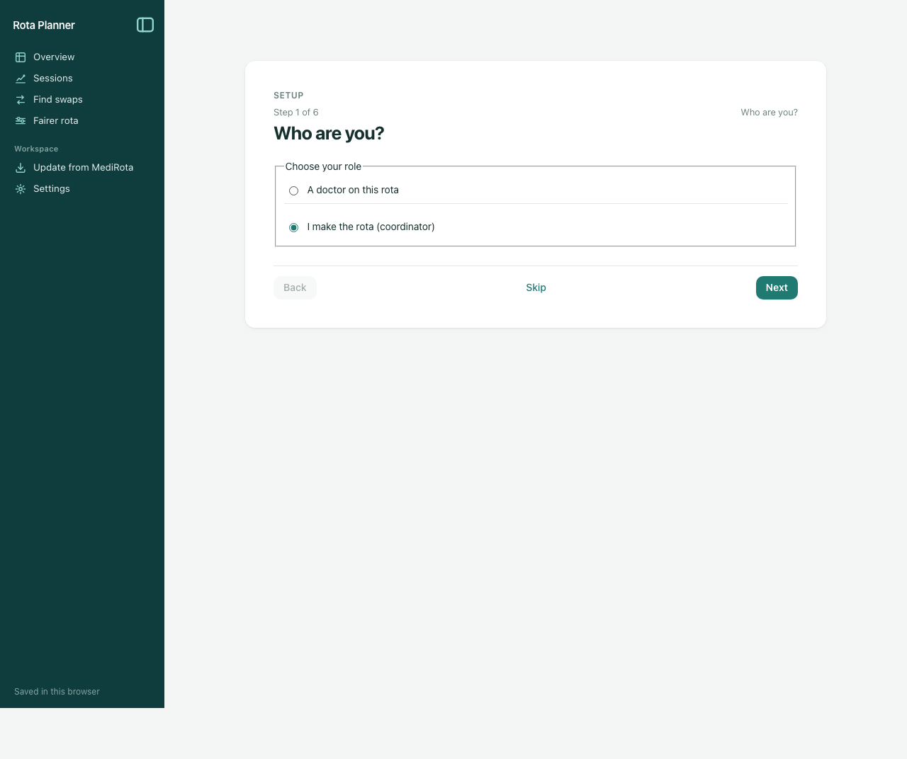
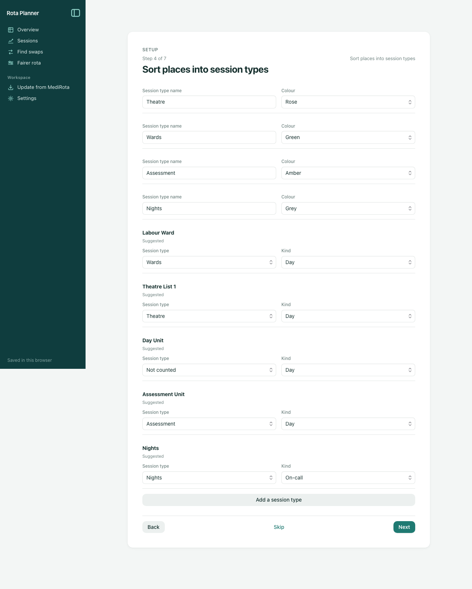

# MediRota Rota Planner

A free tool for **rota coordinators and doctors** whose department uses MediRota.
Bring your rota in from MediRota, then:

- **Overview**: see everyone's rota for the next few weeks at a glance.
- **Sessions**: check the mix of sessions each doctor is getting (theatre, wards,
  clinics, nights or whatever your department uses) and compare doctors in the same
  grade group.
- **Find swaps**: find people who could cover a leave request or swap a day, while
  keeping rest rules and minimum staffing.
- **Fairer rota**: suggest small changes to day sessions that share them out more
  fairly, and show exactly what would change.

**Open it here: https://kshamiyah.github.io/medirota-rota-planner/**

It works in Chrome, Edge, Safari or Firefox, with nothing to install.

It is not affiliated with MediRota. It only reads the rota pages you can already
see; it never changes anything in MediRota.



## Your data stays on your computer

Rota Planner runs entirely in your web browser. There is no account, and your rota
is never sent anywhere. Your rota is saved in your browser's own storage on
your computer. **Settings → Files and presets → Save to file** makes a backup file
that you can keep or move to another computer.

The app's files are delivered by GitHub Pages, but your rota is never sent back.
It is saved for the `kshamiyah.github.io` address in that browser. Other pages on
the same address could in principle read it, so no other sites are kept there.

Your rota contains colleagues' names, so treat any saved file the way your trust
asks you to treat staff information, and delete files you no longer need.

## Getting started

Open **https://kshamiyah.github.io/medirota-rota-planner/** and follow the setup.

Use the same browser and the same link each time, because your rota is saved in
that browser. A different browser or computer starts empty; use **Save to file**
and load the file there to move your rota across.

## First-time setup

The app walks you through setup. Every step can be skipped and changed later in
**Settings**.

1. **Who are you?** A doctor on the rota, or the person who makes it. Coordinators
   see the whole department; doctors also see their own rows highlighted.
2. **Get your rota from MediRota.** Drag the bookmark the app gives you to your
   bookmarks bar, open MediRota, sign in, go to a **By person** week and click the
   bookmark. It collects the weeks and sends them back to the app for you to review.
3. **Which doctor are you?** (doctors only)
4. **Sort places into session types.** The app suggests a type from each place's
   name (for example "Theatre List 1" → Theatre). Check and change them.
5. **Group grades.** Choose which grades are compared with each other.
6. **Session ratios.** All start at 1. Change them only if you know your
   department's values.
7. **Minimum doctors per day.** Find swaps warns when a swap would leave fewer
   doctors than this. Leave blank for no minimum.

The app never invents department rules: suggestions are only a starting point for
you to confirm.



## Sharing a department setup

Once your session types, groups and ratios are right, **Settings → Files and
presets → Save setup as preset file** saves them without anyone's rota. A
colleague can load that file with **Load a preset** to start with the same setup.

## For developers

React and TypeScript, built with Vite. The rota engine uses
[HiGHS](https://highs.dev), an open-source optimisation solver that runs in the
browser.

To run it on your own computer you need [Node.js](https://nodejs.org) (version
20.19 or later):

```bash
git clone https://github.com/kshamiyah/medirota-rota-planner.git
cd medirota-rota-planner
npm install --legacy-peer-deps
npm run dev         # then open the address it prints (usually http://localhost:5173)
```

A local copy keeps its own saved rota, separate from the hosted link.

```bash
npm test            # unit and regression tests (some solver tests take several minutes)
npm run typecheck
npm run build       # static site in dist/
BASE_PATH=/medirota-rota-planner/ npm run build   # for a sub-folder, as on GitHub Pages
```

Every push to `main` publishes the site through `.github/workflows/pages.yml`.

```
src/engine/   data model, solver, independent rota checker, swap search
src/app/      the app: pages/, components/, store.ts, MediRota import and bookmark
test/         tests; all names and departments in fixtures are made up
```

Please never put real names or real rota pages in issues, pull requests or test
fixtures.

## Licence

MIT. See [LICENSE](LICENSE).
